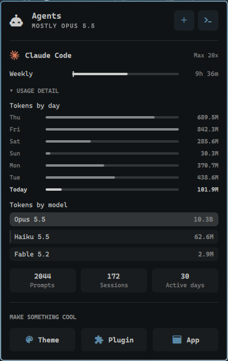

# Agent Insights

An Omarchy bar widget that replaces the stock **Agents** widget (`omarchy.agents`)
and restores the usage detail Omarchy 4.5 folded into a single rotating line:

- **Tokens by day**: the last 7 days, scaled to the busiest one. Hovering today shows its prompts and sessions.
- **Tokens by model**: all-time tokens per model, scaled to the heaviest. Hovering shows the input, output, cache-read, cache-write and today split.
- **All-time totals**: prompts, sessions, and active days.

Everything else is the stock 4.5 panel, unchanged: limit meters, accounts and autoswitch, sign-in, and adding a subscription. Each
subscription's detail section can be collapsed. The collapsed state lasts while the shell runs.

Tested with Omarchy **4.5.0-3** (see `UPSTREAM_VERSION`). The new labels are English only;
the stock strings stay translated.



## How it works

This plugin only changes the display. The data comes from Omarchy's own collectors
(`omarchy-agent-usage-update`), which keep writing
`~/.local/state/omarchy/agents/usage/*.json` and keep updating with Omarchy. The
plugin reads those records and makes no network calls of its own. The manifest sets
`omarchy.clonedFrom: "omarchy.agents"`, the same as `omarchy plugin clone`, so
`omarchy-shell omarchy.agents <open|close|toggle|refresh>` keeps working.

| File | Origin |
|---|---|
| `Panel.qml`, `Main.qml`, `Agent.qml`, `assets/` | Copied from Omarchy's `shell/plugins/agents/`, plus `hook.patch` |
| `manifest.json` | Generated from upstream's by `sync-upstream.sh` |
| `StatsSection.qml` | New: the restored detail views |
| `hook.patch`, `sync-upstream.sh` | Re-base on a new Omarchy release |

## Install

```bash
omarchy plugin add https://github.com/JaimeStill/omarchy-agent-insights.git --yes
```

Then swap `omarchy.agents` for `jaimestill.agent-insights` in `bar.layout` in
`~/.config/omarchy/shell.json`. Settings such as `refreshIntervalSec`, `syncMode` and `providers`
are the same as the stock widget's and go on the new entry.

## Upstream

See [UPSTREAM.md](UPSTREAM.md) for how to merge changes from future Omarchy releases.
